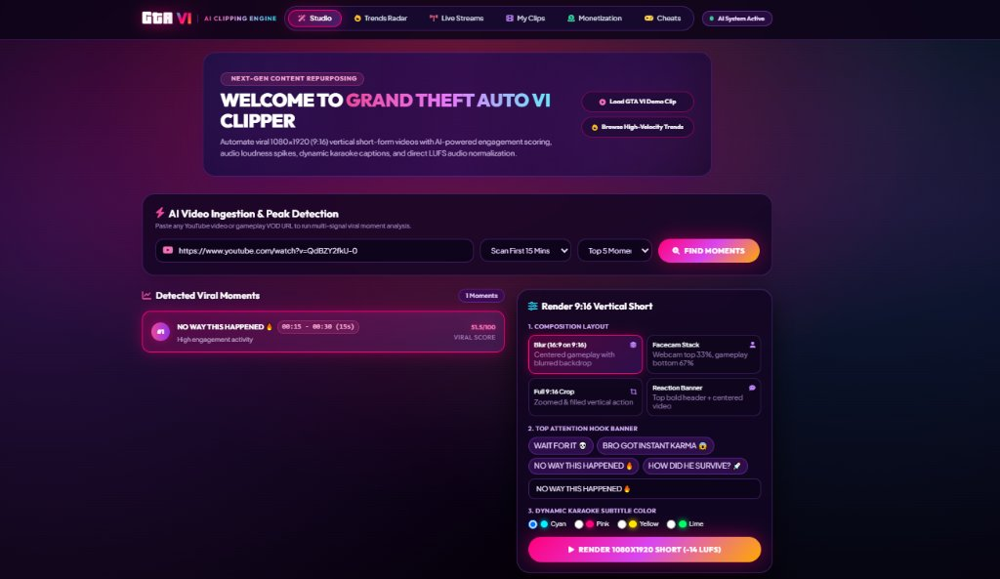

# 🎬 GTA VI AI Video Clipping & Repurposing Engine

An automated AI-powered video clipping and repurposing engine designed to ingest long-form gaming videos and live streams, identify high-engagement viral moments using multi-signal AI analysis, and automatically render polished **1080×1920 (9:16)** vertical clips formatted for TikTok, YouTube Shorts, and Instagram Reels with dynamic karaoke subtitles, hook banners, and -14 LUFS audio normalization.



---

## 📋 Prerequisites

Before running the project, make sure you have:
- **Python 3.10+** installed
- **FFmpeg & FFprobe** installed and accessible from system PATH

---

## ⚡ Installation

1. **Clone the repository:**
   ```bash
   git clone https://github.com/istiakmahmudnewaz/gtavi-ai-clipper.git
   cd gtavi-ai-clipper
   ```

2. **Install Python dependencies:**
   ```bash
   pip install -r requirements.txt
   ```

---

## 🚀 How to Use

### 1. Launch the Web Studio
Run the application server:
```bash
python app.py
```
Open your browser and navigate to: **[http://localhost:5050](http://localhost:5050)**

---

### 2. Find Viral Moments
1. **Enter URL**: Paste any YouTube video URL or long-form gameplay VOD link.
2. **Scan Duration**: Select how many minutes to scan (e.g., `Scan First 15 Mins`).
3. **Number of Moments**: Choose how many top candidate moments to extract (e.g., `Top 5 Moments`).
4. **Click "FIND MOMENTS"**: The multi-signal AI engine extracts audio, transcribes speech with Faster-Whisper, and scores viral peaks based on loudness spikes and verbal hype.

---

### 3. Customize & Render 9:16 Vertical Short
1. **Select Candidate**: Click on any detected viral moment card from the results list.
2. **Choose Composition Layout**:
   - **`Blur`**: 16:9 gameplay centered with a zoomed-in, Gaussian-blurred background.
   - **`Facecam Stack`**: Streamer webcam on top (33%) and gameplay on bottom (67%).
   - **`Full 9:16 Crop`**: Fullscreen vertical action crop.
   - **`Reaction Banner`**: Top bold reaction header + centered gameplay.
3. **Set Attention Hook Banner**:
   - Choose a preset or type your custom header (e.g., `WAIT FOR IT 💀`, `NO WAY THIS HAPPENED 🔥`).
4. **Choose Dynamic Subtitle Neon Color**:
   - Pick Cyan, Pink, Yellow, or Lime for word-by-word synchronized karaoke captions.
5. **Click "RENDER 1080x1920 SHORT (-14 LUFS)"**:
   - FFmpeg automatically cuts the segment, applies vertical composition filters, generates synchronized `.ass` subtitles, and normalizes audio to the social media standard **-14 LUFS**.

---

### 4. Preview & Download
- Preview the rendered clip in the real-time vertical HTML5 video player.
- Click **Download MP4** to save the video directly to your computer, ready for uploading to TikTok, YouTube Shorts, or Instagram Reels.

---

## 💻 CLI Usage (Optional)

You can also run all pipeline steps directly via command line:

```bash
# 1. AI Viral Moment Detection
python -m scripts.moments "https://www.youtube.com/watch?v=VIDEO_ID" --top 5 --max-minutes 15

# 2. Render Vertical Short
python -m scripts.cut jobs/JOB_ID --start 15.0 --end 45.0 --layout blur --hook "WAIT FOR IT 💀" --color cyan

# 3. Multi-Language Dubbing
python -m scripts.translate jobs/JOB_ID/clips/clip_1_blur.mp4 --lang es
```

---

## 📄 License
MIT License - Free to use and modify.
